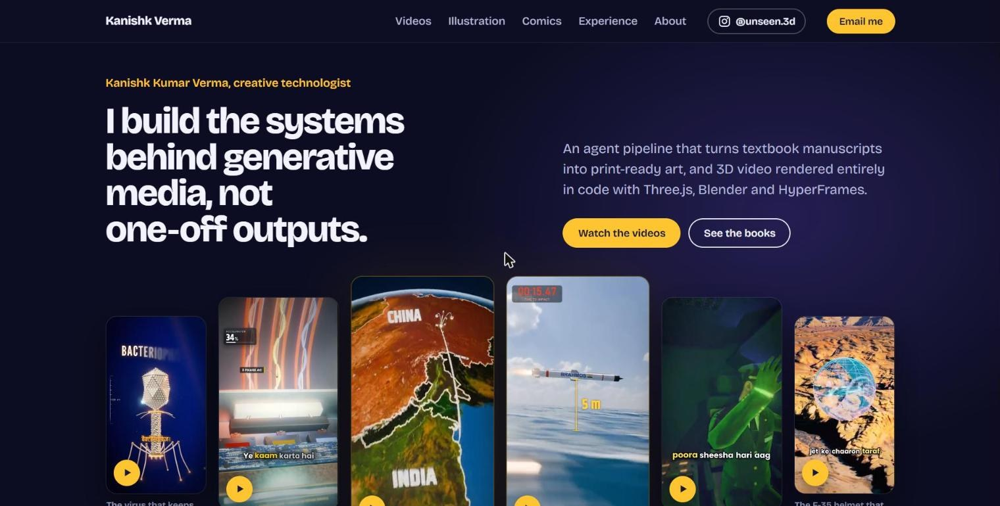
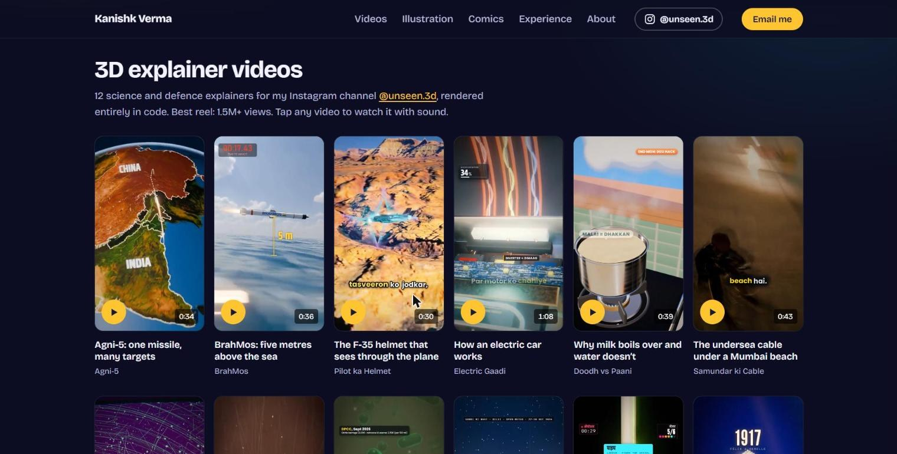
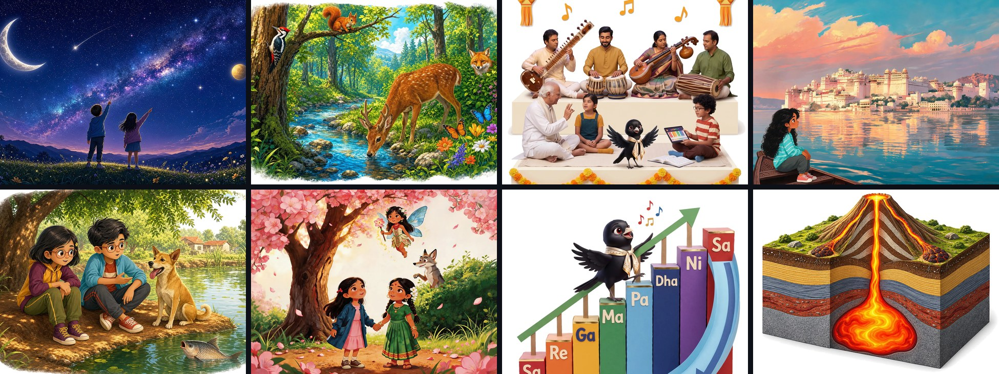
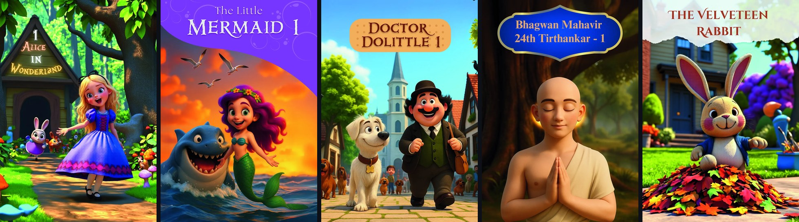

<div align="center">

# Kanishk Kumar Verma · Portfolio

### I build the systems behind generative media, not one-off outputs.

**[▶ kannisshk.pages.dev](https://kannisshk.pages.dev)**


<a href="https://kannisshk.pages.dev"></a>

</div>

<table>
<tr>
<td align="center" width="25%"><h2>1,500+</h2>print-ready illustrations</td>
<td align="center" width="25%"><h2>10+</h2>textbooks</td>
<td align="center" width="25%"><h2>25+</h2>illustrated comics</td>
<td align="center" width="25%"><h2>13</h2>3D explainer videos, rendered in code</td>
</tr>
</table>

> **Looking for the work, not the code?** → **[kannisshk.pages.dev](https://kannisshk.pages.dev)**. This repository is the source that builds it.

---

## What's on the site

### 3D explainer videos
Science and defence explainers for [@unseen.3d](https://www.instagram.com/unseen.3d/): Agni-5, BrahMos, S-400, the F-35 helmet, an electric car's motor and more. Every scene is built in code (Three.js, Blender, HyperFrames) by an AI agent I direct. How they are made → [agentic-3d-explainer-pipeline](https://github.com/Kanishk688/agentic-3d-explainer-pipeline)



### Textbook illustration
Science, music and English textbooks, made with my AI pipeline at Possibility Edutech (Jaipuria Group) and printed for 60+ schools. How they are made → [genai-illustration-pipeline](https://github.com/Kanishk688/genai-illustration-pipeline)



### Comics
Five illustrated comics, 192 pages, made at Wippi in 2025, before AI could reliably keep a character the same across pages.



---

## What this repo shows

| Skill | Where to look |
|---|---|
| **Content-driven architecture**: each book is one Markdown file and each video one data entry; pages, routes and counts build themselves | `src/content/` · `src/data/` |
| **Performance on a media-heavy site**: static Astro, WebP images, videos that play only when on screen | `src/components/` |
| **Design system**: dark premium theme, bento grids, responsive from phone to desktop | `src/styles/global.css` |
| **Shipping**: Cloudflare Pages deploys, custom build and publish flow | [Deployment](#deployment) |

## Tech

- **[Astro 5](https://astro.build)**: static output with zero client JS by default, so pages load instantly
- **[Tailwind CSS 4](https://tailwindcss.com)**: via the Vite plugin, no config file needed
- **Cloudflare Pages**: global hosting

Image- and video-heavy portfolios live or die on load time, which is why this is static Astro rather than a JS framework. The artwork is the payload, so nothing else competes for bandwidth.

## Local development

```bash
npm install
npm run dev        # http://localhost:4321
npm run build      # static output to dist/
npm run preview    # preview the production build
```

Node version is pinned in `.node-version`.

## Structure

```
src/
├─ content.config.ts              content-collection schema
├─ content/projects/*.md          one Markdown file per book or comic
├─ data/                          video list for the explainer and chapter-video sections
├─ pages/
│  ├─ index.astro                 landing: hero video wall, videos, books, comics, about
│  ├─ work.astro                  all case studies
│  └─ work/[...slug].astro        renders each project from the collection
├─ components/                    hero wall, video cards and player, project and experience cards
├─ layouts/Layout.astro           page shell
└─ styles/global.css
public/                           images, videos and static assets
readme/                           images used in this README
```

Case studies are a **content collection**, so adding a book is one Markdown file in `src/content/projects/`. The route, the work index and the home-page sections all pick it up automatically.

## Deployment

The Cloudflare Pages project (`kannisshk`) is **direct-upload, not git-connected**: pushing to `main` saves history but does not deploy. Publish explicitly:

```bash
npm run build
npx wrangler pages deploy dist --project-name=kannisshk
```

`netlify.toml` deliberately skips Netlify builds (`ignore = "exit 0"`). The site moved to Cloudflare and the config stays only to stop the old Netlify project burning build minutes.

---

## More of my work

| | |
|---|---|
| 🎬 **[Agentic 3D Explainer Pipeline](https://github.com/Kanishk688/agentic-3d-explainer-pipeline)** | Cinematic 3D defence and science videos, every scene built in code by an AI agent |
| 🎨 **[GenAI Illustration Pipeline](https://github.com/Kanishk688/genai-illustration-pipeline)** | Manuscript → print-ready textbook art, 1,500+ illustrations shipped |
| 🌐 **[Portfolio website](https://github.com/Kanishk688/portfolio_website)** | The live site: [kannisshk.pages.dev](https://kannisshk.pages.dev) |
| 🧩 **[Pipeline Builder](https://github.com/Kanishk688/react-flow-pipeline-builder)** | Node-based workflow editor with graph validation, React + FastAPI |

<sub><b>Kanishk Kumar Verma</b> · Creative technologist · <a href="https://kannisshk.pages.dev">kannisshk.pages.dev</a> · <a href="https://www.linkedin.com/in/kanishk-verma-b0929021b/">LinkedIn</a> · <a href="mailto:kanishkverma688@gmail.com">kanishkverma688@gmail.com</a></sub>
